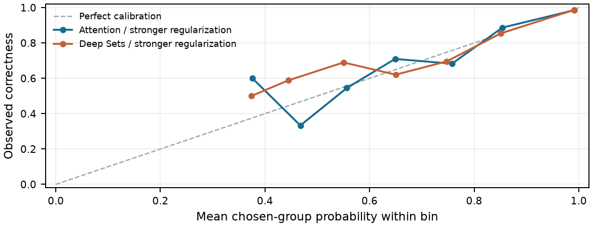

Reliable answer selection
Performance research v2

DASE7506 - Advanced Machine Learning Methods
Student 3036900957 | 29 October 2026 | Independent research/performance-v2 branch

Research question

Can answer-group alignment and small learned nonlinear candidate interactions improve the difficult disagreements in the supplied four-candidate bank, within a small CPU inference budget? The research separates decoding, objective and architecture changes, then uses common train-only out-of-fold (OOF) comparisons before a one-way validation confirmation.

Scope and status

The original submitted release and frozen checkpoint remain intact. Its previously observed test total, 348/467 (74.5182%), was already known when this work began. The present study is subsequent development, not an untouched independent experiment. No new test score or rank is reported. New formal test scoring and score updates remain closed unless an explicit applicable course process permits them.

Nineteen configuration/seed runs completed the same nested train-only three-fold protocol; the old test aggregate was already known.

Attention has stronger seed-averaged train OOF evidence. Deep Sets was selected by the preregistered two-finalist validation rule; its two-question lead over Attention does not establish stable family superiority.

Selected Deep Sets improved observed validation from 724/798 to 740/798, hard 282/355 to 297/355, and single-positive 59/117 to 68/117.

Mask/group decoding helped old linear OOF, but MLP group loss, hard normalization, Deep Sets learned pooling and the unique equal mixture did not show the hypothesized additional gains.

All model choices were locked before new validation. No search reopened after confirmation. Old assets, logs, guards and course Issue #294 are preserved.

No new test evaluation or grade/rank update was performed. An explicit applicable course reevaluation process remains required.

Original model and motivation

The original 2064-dimensional representation combines each 1024-dimensional embedding, its absolute deviation from the same-question mean, and 16 cosine/parse/vote/text statistics. A standardized linear scorer uses a multi-positive listwise objective but selects the highest-scoring individual candidate. Thus it already has engineered relations, while lacking learned multilayer interactions. Shared scalar features cancel in linear within-question ranking; the absolute deviation features do not.

| Known original validation | Correct / questions | Interpretation |

| --- | --- | --- |

| Overall | 724 / 798 (90.73%) | 379 questions have four correct candidates |

| Hard: >=2 distinct valid answers | 282 / 355 (79.44%) | Fixed input-derived difficult subset |

| Exactly one correct candidate | 59 / 117 (50.43%) | Label-derived diagnostic, never an inference feature |

The official scorer checks the final numeric answer, not the logical validity of every reasoning step. All new numeric results below come from saved execution artifacts.

---

1. Task-aligned selection and losses

The unchanged official parser groups candidates by normalized numeric answer. Invalid parses have no answer group. With at least one valid candidate, they are excluded; when only one valid group remains, the course guarantee of at least one correct candidate determines the answer group. A fully unparseable synthetic bank falls back deterministically to original index 0, with diagnostics.

| Decoder | Definition / role |

| --- | --- |

| Raw candidate max | Original argmax over all four scores; reproduces the old baseline |

| Masked candidate max / group max | Exclude invalid parses. Both rules are mathematically equivalent, including the implemented tie convention |

| Group LSE | S(a) = log sum exp(s(j)/tau), j in answer group a |

| Normalized group LSE | S(a) = log sum exp(s(j)/tau) - alpha log |G(a)|; alpha in {0, 0.5, 1}, tau=1 |

After choosing a group, return its highest-scoring member as an original Python integer index. Equal scores use the smallest original index; exact indistinguishable ties are the documented exception to permutation equivariance. Repeated same-answer trajectories are correlated: LSE is an aggregation rule, not a proof of independent evidence.

Objective controls

The legacy loss is LSE(all candidate scores) - LSE(correct candidate scores). The group objective is LSE(valid group logits) - logit(correct answer group). With alpha=0, tau=1 and all candidates valid, these are identical. Parse masks, alpha or the normalization denominator must be identified separately when attributing gains. BCE preserves every positive candidate; multiple correct candidates are never converted into mutually exclusive negative labels.

Questions whose candidates are all correct provide zero listwise ranking gradient. After masking, a single valid-answer group likewise supplies no group discrimination gradient. A hard-only mean rescales the data loss. Linear L2 is adjusted by the fitting subset hard fraction to preserve the equivalent objective; AdamW decay scaling is only a controlled comparison, not an identical optimization trajectory.

Small architectures, randomly initialized

| Architecture | Task-specific structure | Parameters |

| --- | --- | --- |

| MLP | 2064 -> 128 -> 64 -> 1, shared candidate scorer | 272,641 |

| ResMLP | Width 128, pre-LayerNorm residual block, expansion 2, shared head | 330,625 |

| Deep Sets | 1024 -> 128 -> 128 phi; h, mean, max, |h-mean|, h*mean and 16 statistics -> rho | 231,937 |

| Attention | Four tokens, width 128, four heads, FFN 256, no positional encoding | 273,025 |

These are original compact adaptations inspired by the cited papers [2-4], not claims to reproduce their complete benchmark systems. No pretrained weights, extra task data, teacher LLM outputs or external answer retrieval are used.

---

2. Common-fold research protocol

Only the official 4,755 training questions fit parameters. Three outer question-level folds are shared by every main family, stratified by positive count and valid-answer count with rare strata merged. All four candidates stay with their question. A fixed 20% inner subset of each outer training partition selects the stopping epoch. A fresh model and scaler are then fitted on the complete outer training partition for that fixed epoch count. Outer labels never choose epochs.

Scalers use the corresponding fitting partition only. Final all-train neural epochs are the rounded-up median of the three inner-selected epochs. The initial seed is 3036900957; promising structures add the two fixed seeds 3036900958 and 3036900959. Deployment does not choose the luckiest seed. Selection prioritizes mean hard OOF accuracy, then full accuracy, stability and resource cost.

All accuracy values are question-level. Hard always means at least two distinct valid parsed answers. The complete official denominator is retained; the single-positive subset is diagnostic only. OOF is still optimistic after architecture/hyperparameter selection, and seed repeats do not create independent observations. Question-paired bootstrap intervals quantify a selected comparison, not the full uncertainty of adaptive research.

Main common-three-fold results

| Completed model / objective | Full mean +/- SD (%) | Hard mean +/- SD (%) | Parameters | Actual MiB | Fit seconds |

| --- | --- | --- | --- | --- | --- |

| Linear / group CE alpha=0 | 89.21 +/- 0.54 | 75.73 +/- 1.21 | 2,065 | 0.049 | 14.3 |

| Linear / group CE alpha=0.5 | 89.09 +/- 0.28 | 75.45 +/- 0.61 | 2,065 | 0.049 | 14.5 |

| Linear / group CE alpha=1 | 88.94 +/- 0.22 | 75.12 +/- 0.48 | 2,065 | 0.049 | 13.0 |

| Linear / hard-normalized group CE | 89.21 +/- 0.54 | 75.73 +/- 1.21 | 2,065 | 0.049 | 13.0 |

| Linear / original listwise | 88.60 +/- 0.32 | 74.55 +/- 0.65 | 2,065 | 0.049 | 11.7 |

| Attention / group CE | 90.62 +/- 0.82 | 78.90 +/- 1.85 | 273,025 | 1.078 | 41.7 |

| Attention / hard-normalized CE | 90.87 +/- 0.40 | 79.47 +/- 0.89 | 273,025 | 1.078 | 133.3 |

| Attention / stronger regularization | 91.02 +/- 0.32 | 79.80 +/- 0.72 | 273,025 | 1.078 | 133.3 |

| Deep Sets / group CE | 90.20 +/- 0.51 | 77.96 +/- 1.14 | 231,937 | 0.919 | 34.3 |

| Deep Sets / learned pooling removed | 90.35 +/- 0.38 | 78.29 +/- 0.87 | 166,401 | 0.669 | 86.9 |

| Deep Sets / stronger regularization | 90.33 +/- 0.42 | 78.24 +/- 0.96 | 231,937 | 0.919 | 117.8 |

| MLP / matched capacity | 89.25 +/- 0.38 | 75.83 +/- 0.84 | 232,190 | 0.920 | 42.8 |

| MLP / group CE | 89.17 +/- 0.22 | 75.64 +/- 0.52 | 272,641 | 1.074 | 32.1 |

| MLP / original listwise | 89.44 +/- 0.57 | 76.25 +/- 1.25 | 272,641 | 1.074 | 25.9 |

| ResMLP / group CE | 89.19 +/- 0.31 | 75.69 +/- 0.69 | 330,625 | 1.296 | 27.4 |

All rows completed the same three outer folds; SD is the sample fold SD. Actual MiB is the maximum audited complete fold-bundle size, counting uncompressed containers, not just numeric parameter bytes. Fit seconds include recorded inner-stopping and refit work; invocation wall time is retained separately. All nonfinalist validation entries are not evaluated by protocol. Counts and every additional seed/configuration are retained in the complete linked analysis.

The no-pooling Deep Sets ablation retains the 16 input statistics (including existing vote/cosine information) and reduces parameter count. It removes learned pooled interactions, not every source of context, and alone does not separate interaction from capacity. The matched-capacity MLP is an additional control.

TabM was not run. The optional additional family actually evaluated was four-candidate attention; no TabM performance is estimated or implied.

---

3. Controlled decoding and seed stability

| Same original linear scores | Full correct/n | Hard correct/n | Hard mean +/- SD (%) |

| --- | --- | --- | --- |

| registered | 4213/4755 | 1576/2114 | 74.55 +/- 0.65 |

| mask_max | 4219/4755 | 1578/2114 | 74.65 +/- 0.81 |

| group_max | 4219/4755 | 1578/2114 | 74.65 +/- 0.81 |

| group_lse_a0 | 4245/4755 | 1604/2114 | 75.88 +/- 0.37 |

| group_lse_a0.5 | 4236/4755 | 1595/2114 | 75.45 +/- 1.11 |

| group_lse_a1 | 4193/4755 | 1552/2114 | 73.42 +/- 0.62 |

These rows isolate inference changes on identical OOF scores. Group-max is an implementation-equivalence check against masked candidate-max. None values are never counted as an answer group. The already-known v1 validation baseline is replayed separately, without opening new test evaluation.

Fixed-seed stability

| Configuration | Fixed seeds | Mean hard (%) | Seed SD (pp) |

| --- | --- | --- | --- |

| attention / group / wd=0.01 | 3036900957, 3036900958, 3036900959 | 79.41 | 0.38 |

| deepsets / group / wd=0.01 | 3036900957, 3036900958, 3036900959 | 78.73 | 0.44 |

For each seed, the same three outer folds are reused; the reported seed SD is across mean hard fold accuracies, not an uncertainty estimate from independent datasets. Deployment uses the preregistered base seed rather than choosing the highest seed score.

Selected question-paired OOF comparisons

| First minus second | Full extra correct | Hard extra correct | Hard delta pp [95% CI] |

| --- | --- | --- | --- |

| attention_hard_ablation vs attention_regularized_s0 | -7 | -7 | -0.33 [-0.80, +0.09] |

| attention_regularized_s0 vs attention_group_s0 | 19 | 19 | +0.90 [+0.00, +1.84] |

| attention_regularized_s0 vs linear_original | 115 | 111 | +5.25 [+3.64, +6.86] |

| attention_regularized_s0 vs linear_original::group_lse_a0 | 83 | 83 | +3.93 [+2.41, +5.39] |

5,000 question-paired bootstrap draws; intervals are conditional on selected OOF predictions and do not remove model-selection optimism. Further comparisons, all individual folds and selected-candidate confidence diagnostics are preserved in analysis.json.

What the ablations support

Group-objective alignment was not uniformly better: the MLP group-loss control selected 1599/2114 hard questions correctly, versus 1612/2114 with the original listwise loss. Removing learned Deep Sets pooling gave 1655/2114, compared with 1654/2114 for pooled Deep Sets. This does not establish a benefit from that specific pooling design; retained statistics and changed capacity limit causal attribution.

The regularized neural configuration changed dropout, learning rate and AdamW decay together. Its comparison evaluates that registered configuration, not the separate causal effect of each knob. The hard-normalization control is reported independently; a smaller loss denominator is not itself evidence for a stronger architecture.

---

4. Complementary errors did not guarantee a gain

The predeclared complementarity gate was met: the first model alone corrected 71 errors of the second, and the second alone corrected 38 of the first. Their hard-set oracle gain over the stronger member was 1.80 percentage points. An oracle uses unavailable correctness information and is only a diagnostic upper bound.

Exactly one equal-weight average of aligned answer-group probabilities was evaluated on the shared OOF predictions. Raw logits were not averaged, no mixture weight grid was tried, and no validation references were used to tune or fit the combination.

| OOF method | Full mean +/- SD (%) | Hard mean +/- SD (%) | Hard correct/n |

| --- | --- | --- | --- |

| Attention / stronger regularization | 91.02 +/- 0.32 | 79.80 +/- 0.72 | 1687/2114 |

| Deep Sets / stronger regularization | 90.33 +/- 0.42 | 78.24 +/- 0.96 | 1654/2114 |

| Equal probability mixture | 90.75 +/- 0.32 | 79.19 +/- 0.74 | 1674/2114 |

The mixture changed the hard result by -13 correct questions relative to Attention / stronger regularization: -0.61 percentage points, with a paired 95% interval [-1.28, +0.05]. It was not retained for deployment or new validation scoring. The interval does not establish a systematic loss, but the predeclared comparison provided no reason to add the extra model.

| Measured OOF combination cost | Value |

| --- | --- |

| Combined model parameters | 504,962 |

| Sum of audited member bundle assets | 2,094,209 bytes (1.997 MiB) |

| Additional fitting | 0.000 seconds |

| Previously recorded member fitting reused | 251.061 seconds |

| Probability combination (in-process) | 0.0237 seconds |

| New official validation / test | Not evaluated / disabled |

The member-asset sum is an actual inventory, not a deployed wrapper size. A deployed mixture would also have to count its configuration and measure a fresh prediction-plus-scoring process; no such claim is made for this rejected OOF combination.

Recorded timing deviation

The first seed batch had a 900-second wall budget. Its first experiment completed after 1124.3837 seconds (1098.3894 seconds of summed fitting wall intervals); the parent stopped before starting the next experiment. This cap was exceeded in the observed run. The completed seed, fold predictions and logs were retained, then remaining registered seeds resumed. The cause of the long wall interval is unestablished; no guessed CPU-only time replaces it. See BUDGET_DEVIATION.md.

---

5. Locked validation confirmation

The search was closed and at most two finalists, configurations, decoders and assets were locked before new validation access. All 798 validation questions were predicted before their references were loaded for diagnostics. No result on this page reopens architecture or hyperparameter search.

| Finalist | Full correct/n | Hard correct/n | Single-positive correct/n |

| --- | --- | --- | --- |

| Frozen v1 (replayed) | 724/798 (90.73%) | 282/355 (79.44%) | 59/117 (50.43%) |

| Attention / stronger regularization | 738/798 (92.48%) | 295/355 (83.10%) | 70/117 (59.83%) |

| Deep Sets / stronger regularization [selected] | 740/798 (92.73%) | 297/355 (83.66%) | 68/117 (58.12%) |

Paired differences from the preserved v1 selector

| Finalist minus v1 | Full delta [95% paired CI] | Hard delta [95% paired CI] |

| --- | --- | --- |

| Attention / stronger regularization | +14 correct; +1.75 pp [+0.25, +3.26] | +13 correct; +3.66 pp [+0.28, +7.04] |

| Deep Sets / stronger regularization | +16 correct; +2.01 pp [+0.38, +3.51] | +15 correct; +4.23 pp [+0.85, +7.89] |

The intervals use 5,000 paired question resamples and remain conditional on the small preselected finalist set. Counts on the single-positive subset disclose a possible tradeoff rather than serving as a new selection objective.

The preregistered validation rule selected Deep Sets / stronger regularization. Relative to the other locked finalist, it changed full validation by +2 questions and the single-positive subset by -2. This small between-finalist difference does not establish stable architectural superiority; train-OOF and fixed-seed evidence must be read alongside it. No hyperparameters or seeds were changed after confirmation.

---

6. Resource checks and reliability

Reported deployment costs include every selected model and preprocessing artifact. Training cost appears separately in the common-fold table. The official constraints are at most 16 MiB of uncompressed extra assets and at most 30 seconds for complete CPU prediction plus independent scoring, with no more than four total compute threads.

| Finalist | Final epochs | All assets MiB | Fresh predict + score seconds | Brier | ECE |

| --- | --- | --- | --- | --- | --- |

| Attention / stronger regularization | 8 | 1.078 | 1.762 | 0.0517 | 0.0163 |

| Deep Sets / stronger regularization | 9 | 0.919 | 1.740 | 0.0541 | 0.0161 |

Assets count every deployed file using uncompressed container sizes. Time encloses fresh CPU prediction and a separate official scoring process, including imports, loading and preprocessing. Brier/ECE concern the actual selected group; probabilities are uncalibrated and the old calibrator is not reused. This is local measurement, not reference-Xeon certification.

Reliability diagram: ten equal-width probability bins; empty bins are omitted. Each plotted value is an aggregate of already saved validation diagnostics. A point near the diagonal does not establish calibration under hidden-bank distribution shift.

Independent environment reproduction

A fresh public clone at frozen commit 36f9617175321a2861e78bb2f4ffcde643c4fc03 and a new NumPy-only environment independently downloaded official validation inputs/references. The preserved checkpoint reproduced 740/798; all 798 selected indices matched the original confirmation. All 20 frozen source/asset hashes matched. Complete fresh prediction plus separate scoring took 0.7323 seconds. The checkpoint was not retrained; no train or test data were present.

Reproduction dependencies: numpy==2.5.3. The different local timing is retained alongside the original confirmation timing, rather than replacing it. Evidence: results/research_v2/clean-reproduction.

The artifact audit inventories numeric arrays and complete uncompressed containers. Synthetic contract checks exercise arbitrary N, changed IDs, question/candidate permutations, valid/invalid parses, reference-free offline inference and NumPy-only imports. Full finalist export comparison separately checks all validation input scores and selected indices against Torch without opening references.

---

Reproducibility, limits and disclosure

Frozen v2 inference source: <link href="https://github.com/liuqichang0305/dase7506-mp2-solution/tree/36f9617175321a2861e78bb2f4ffcde643c4fc03">36f9617175321a2861e78bb2f4ffcde643c4fc03</link>
Checkpoint: artifacts/research_v2/final_deepsets
Evaluation state: Frozen validation reproduction and audit only; course-specific new test/score update process pending confirmation

Every completed experiment retains its ID, configuration, seed, source/data hashes, fold membership, OOF scores, fitting logs, failure information and numeric model assets. Existing search guards and v1 assets are preserved. Research entry points reject test evaluation. The independent v2 interface loads only supplied inputs and numeric checkpoint arrays; no reference file, ID lookup, online model or new generation is needed.

Training uses PyTorch on the local CPU. Inference is NumPy-only. Export verification compares complete finalist validation input scores and actual choices against the reconstructed Torch model, without reading reference answers. Fresh-process inference plus a separate official scoring process includes startup, imports, asset loading and features. All deployed members and preprocessing statistics count toward the 16 MiB uncompressed asset limit.

Recorded host: 12th Gen Intel(R) Core(TM) i9-12900H; Windows-11-10.0.26200-SP0; 15.67 GiB RAM. Training/inference use CPU with one configured compute thread. Python 3.12; PyTorch 2.15.0+cpu; NumPy 2.5.3. Local timing does not certify performance on the course reference Xeon Platinum 8457C.

Interpretation limits

The research bank is small, includes many unambiguous or all-positive questions, and differs from difficult hidden evaluation inputs. Full accuracy can mask weakness on disagreements or single-positive cases. Validation was already used in v1 development and is therefore a development confirmation, not a newly untouched test set. Bootstrap intervals do not eliminate OOF selection bias, repeated-development bias or distribution shift. A validation-hard percentage cannot be read as a promised test percentage or rank.

Confidence is evaluated for the actually selected answer group. Raw group probabilities are not automatically calibrated correctness probabilities, and the old candidate-max calibrator is not reused. Brier and ECE are descriptive diagnostics; formal selection never abstains. Ensembles are considered only after paired OOF error complementarity and count all members toward compute and storage.

AI and implementation disclosure

OpenAI Codex agents assisted with design, source inspection, implementation, experiments, testing, documentation and this report. Numerical claims are sourced from saved real runs rather than generated estimates. Neural modules are original task-specific implementations using PyTorch and NumPy; cited architectures are conceptual sources, not imported pretrained artifacts. Independent AI code review is documented as such and is not a substitute for instructor verification.

Reference-repository license checks are saved in docs/research_v2/rules_and_sources.md and results/research_v2/rules_evidence.json: rtdl-revisiting-models and DeepSets use Apache-2.0, while set_transformer uses MIT. These codebases were not copied into the project; the licenses and paper sources are disclosed to distinguish architectural inspiration from code reuse.

Original release: 419e1158ba2f83b8c08796429e635f1bf8ab2977. The v2 freeze records the final source commit, configuration, asset hashes and permitted evaluation state. See docs/research_v2, results/research_v2 and the v2 README commands for the complete table, exact checkpoints, review and fresh-environment reproduction evidence.

References

[1] Course guide and official interface. https://github.com/xudongwu-0/DASE7506-MP2/tree/bb801f4f2e7629d270df765ab12c333b2dc616bb

[2] Gorishniy et al. Revisiting Deep Learning Models for Tabular Data. NeurIPS 2021. https://arxiv.org/abs/2106.11959

[3] Zaheer et al. Deep Sets. NeurIPS 2017. https://arxiv.org/abs/1703.06114

[4] Lee et al. Set Transformer. ICML 2019. https://proceedings.mlr.press/v97/lee19d.html

[5] Gorishniy et al. TabM: Advancing Tabular Deep Learning with Parameter-Efficient Ensembling. ICLR 2025. https://arxiv.org/abs/2410.24210. Optional route; no run is claimed unless present in the experiment table.

[6] PyTorch project, https://pytorch.org/ ; NumPy project, https://numpy.org/ . Software versions and notices are recorded with the environment.
